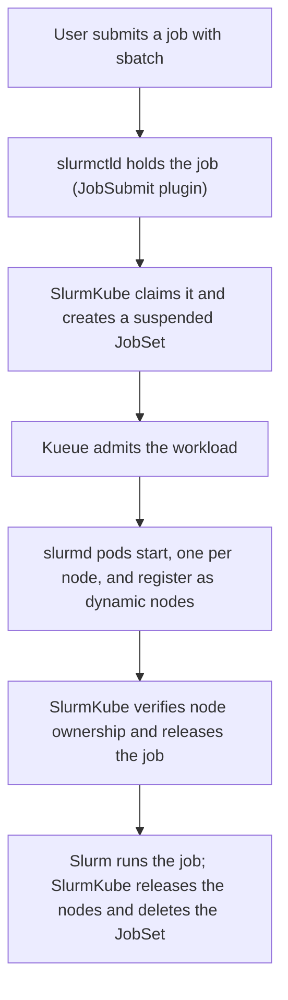

# SlurmKube

**Slurm-native workflows. Kubernetes-native compute.**

SlurmKube enables Slurm workloads to run on shared Kubernetes
infrastructure, submitted and managed with familiar Slurm commands.

Users continue using `sbatch`, `squeue`, and `scancel`, while Kueue
handles workload admission and Kubernetes schedules the compute pods.

Slurm remains the source of truth for job state. SlurmKube bridges the
two systems, managing the Kubernetes resources and dynamic Slurm nodes
required to execute each job. It is designed for teams that run a shared
Kubernetes cluster, including GPU workloads, and want to offer it to
Slurm users as well.

## Why SlurmKube?

- **Keep the Slurm workflow.** Submit, inspect, and cancel jobs with the
  Slurm commands you already use; batch scripts run as they are unless
  they use one of the [refused options](#status).
- **Share Kubernetes compute.** Run Slurm workers as pods on a cluster
  shared with other workloads instead of dedicating nodes to Slurm.
- **Use Kubernetes-native admission.** Kueue admits each job before its
  workers start, so operators apply queue, quota and priority policies
  to Slurm jobs and Kubernetes workloads alike.
- **Recover safely.** SlurmKube checks that every Slurm node belongs to
  the pod it created before a job runs, and requires fencing when a
  vanished pod's host cannot be trusted.

SlurmKube currently integrates with an existing Slurm control plane: it
adds dynamic nodes to a cluster you already operate and does not deploy
`slurmctld` or `slurmrestd` itself. Deploying the Slurm control plane on
Kubernetes as well is planned (see the [Roadmap](docs/roadmap.md)).

## How it works



Each Slurm job becomes one JobSet with one `slurmd` pod per requested
node. The pods register with slurmctld as dynamic nodes named
`slurmkube-w<i>-<jobID>`, recording their pod UID in the node's `extra`
field. SlurmKube releases the held job only after verifying that every
node record belongs to a live pod at the expected endpoint. When the job
ends, SlurmKube releases the node records and removes the JobSet. Slurm
stays the source of truth for the job; Kubernetes supplies the compute.

| Component | Responsibility |
|---|---|
| Slurm | job submission, job state, scheduling onto the registered nodes |
| SlurmKube | job-to-JobSet lifecycle, node ownership checks, release, cleanup |
| Kueue | workload admission under the configured queue policies |
| Kubernetes / JobSet | scheduling and lifecycle of the worker pods |

See [Architecture](docs/architecture.md) and [Lifecycle](docs/lifecycle.md)
for the full design.

## Safety and recovery

SlurmKube treats a dynamic Slurm node as an identity owned by one pod,
not merely as a node name.

- A node record is owned by a pod (its UID in `extra`), never by name.
- A replacement pod starts `slurmd` only when no record exists under its
  name; a finished pod's port is reserved until its record is gone; a
  port a record still names is never handed out.
- A job is released only onto records owned by live pods at the recorded
  endpoint; a requeued job is held until that holds again.
- A record is marked DOWN only when no live pod serves it, and never when
  it is not SlurmKube's.
- A job whose pod vanished on an unreachable host does not run again
  until the host is fenced (`fencing.mode: manual`).

See [Ownership](docs/ownership.md) and [Fencing](docs/fencing.md) for the
invariants and failure cases.

## Status

SlurmKube is at version 0.1. The behaviour below has been reproduced end
to end with slurmctld, slurmrestd, Kueue and JobSet. It has not yet
been proven across sites or at scale (see the [Roadmap](docs/roadmap.md)).

| Area | Confirmed by |
|---|---|
| Job lifecycle (claim → JobSet → admission → verified release → cleanup) | end-to-end, plus unit, race and envtest suites |
| CPU jobs; GPU jobs (`--gres=gpu:1`, `--gres=gpu:8`) with the same CPU, memory and GPU allocation as a static node | end-to-end |
| Multi-node jobs (`-N2`), job arrays (`--array`, including `scancel` and `scontrol requeue` of one task), host selection (`-w`, `-x`), `--requeue` | end-to-end |
| Pod loss while running, single- and multi-node: node record released, job requeued, held until the replacement pods register, then released | end-to-end |
| Fencing: pod lost on a NotReady host, job held until the operator marks the host fenced | end-to-end |
| Kueue preemption by a higher-priority workload: job requeued, held until re-admitted | end-to-end |
| `scontrol update TimeLimit` (extension, shortening, `UNLIMITED`) followed into the Kubernetes deadline, across controller restarts | end-to-end |
| Refused options reported in the job comment and in metrics | end-to-end |
| Cleanup when the JobSet is deleted before its pods: node records released without errors | end-to-end, plus unit tests |
| Heterogeneous-job refusal by the controller (the site's JobSubmit plugin refuses them first); Kubernetes API or slurmrestd outages | unit and envtest suites only; not reproduced end to end |

Not every sbatch option is supported. The following are refused at
submission, with the reason written to the job's comment
(`slurmkube: refused: <option>: <reason>`):

- typed GPUs such as `--gres=gpu:h100:N` (dynamic nodes register untyped GPUs)
- `--gpus-per-socket`
- `--constraint` (the field carries SlurmKube's pin)
- `--array` with `-N` > 1
- heterogeneous jobs

Refused options are different from features that are implemented but
not yet reproduced end to end. [Slurm options](docs/slurm-options.md) lists how
each option is treated; consult it before relying on an option.

## Getting started

This is a deployment outline, not a ready-to-run local demo. It assumes
an existing Slurm control plane with slurmrestd and a Kubernetes cluster
that SlurmKube may create JobSets in.

### Slurm controller requirements

The examples below follow [`config/example.yaml`](config/example.yaml):
node name prefix `slurmkube-w` (the default), node feature `slurmkube`
(`slurmd.nodeFeatures`), partition `k8s`, and GPU device links in
`/run/slurmkube/gres` with 8 links (`slurmd.gresDeviceLinks`). Keep the
Slurm side consistent with whatever your configuration sets.

- `SelectType=select/cons_tres`. SlurmKube sizes pods by its allocation
  rules.
- `MaxNodeCount` at least the static nodes plus the dynamic nodes you
  allow; set `slurmd.maxDynamicNodes` to the difference so jobs wait
  instead of failing to register. Changing it needs a slurmctld restart.
- Configless slurmd (`SlurmctldParameters=enable_configless`). Each pod
  runs `slurmd -Z -b -N <node name> --conf "<features, size, GPUs>"
  --conf-server <slurmd.confServer>` and fetches `slurm.conf` and
  `gres.conf` from slurmctld. `slurmd.confServer` is passed to
  `--conf-server` as written, e.g. `slurmctld.example.com:6817`, or a
  comma-separated list with the primary controller first.
- `TaskPluginParam=SlurmdSpecOverride` when `slurmd.advertiseHostResources`
  is on (as in the chart's values), so the node is limited to the pod's
  CPUs.
- A partition over the dynamic nodes, selected by their feature:

  ```text
  NodeSet=slurmkube Feature=slurmkube
  PartitionName=k8s Nodes=slurmkube
  ```

- `JobSubmitPlugins=lua` with the [JobSubmit plugin](hack/job_submit.lua),
  which holds the partition's jobs with the comment
  `slurmkube: held for admission`.
- JWT authentication for slurmrestd (`AuthAltTypes=auth/jwt`), and a
  Slurm user for the controller (`slurm.jwtUser`, default `slurmkube`)
  with operator rights, which updating node records requires.
- For GPU jobs with `slurmd.gresDeviceLinks`, `gres.conf` lines that
  name the dynamic nodes, with GPU autodetection off, and point them at
  the device links the pod creates. A dynamic node whose name no line
  matches registers without GPUs. [GPU resources](docs/gres.md) has the
  lines, a generator, and why they look the way they do.

### Kubernetes requirements

- [Kueue](https://kueue.sigs.k8s.io/) and
  [JobSet](https://jobset.sigs.k8s.io/).
- The kubelet CPU Manager `static` policy on the worker hosts when
  `slurmd.advertiseHostResources` is on: the controller releases a job
  only when the node's effective CPUs equal the pod's request.
- For GPU jobs, a device plugin that allocates GPUs to pods
  (`slurmd.gpuResourceName`, `nvidia.com/gpu` by default).

### Credentials

The controller authenticates to slurmrestd with either a long-lived
token (`slurm.tokenFile`, key `token` in the Secret) or slurmctld's JWT
signing key (`slurm.jwtKeyFile`, key `jwt.key`), from which it mints
short-lived tokens for `slurm.jwtUser`. The worker pods need `slurm.key`
to authenticate slurmd to slurmctld.

Both keys are highly privileged:

- Whoever holds the JWT signing key can mint a token for any Slurm user,
  including SlurmUser and root, and so control the whole Slurm cluster.
  Prefer a token for the controller's own user (`scontrol token
  username=slurmkube lifespan=...`) if you do not want the signing key in
  Kubernetes. With the signing key the controller renews its tokens
  itself (at half of `slurm.jwtLifetime`, re-reading the key each time);
  a token file is read once at startup, so before the token expires,
  update the Secret and restart the controller
  (`kubectl -n slurm-jobs rollout restart deployment/slurmkube`).
- The chart mounts the token or signing key only into the controller
  pod, and the controller's RBAC grants no access to Secrets. Never mount
  it into worker pods or other workloads.
- `slurm.key` is mounted into every worker pod, readable by root only
  (mode 0600); job processes run as the submitting user and cannot read
  it. A user who can create pods in the namespace, or exec into a worker
  pod, can read it.
- Restrict the namespace with RBAC: only cluster administrators and the
  controller's ServiceAccount should create pods, JobSets or Jobs there
  or read its Secrets. Do not let untrusted users create resources in it.

### Install

1. Install [Kueue](https://kueue.sigs.k8s.io/) and
   [JobSet](https://jobset.sigs.k8s.io/).
2. Create the Kueue objects the configuration names: a `ResourceFlavor`
   and a `ClusterQueue` with quota for `cpu`, `memory` and the GPU
   resource of the worker pods; a `LocalQueue` in the namespace named as
   `localQueue` (`main` in the chart's values); and the
   `WorkloadPriorityClass` that each `partitions` entry names
   (`normal-priority`). The priority class is required: the JobSets
   carry it as their Kueue priority.
3. Create the namespace the controller and its worker pods will run in,
   and put `slurm.key` and the controller's credential into Secrets
   there. The chart mounts these Secrets; it does not create them.

   ```sh
   kubectl create namespace slurm-jobs
   kubectl -n slurm-jobs create secret generic slurm-auth --from-file=slurm.key
   kubectl -n slurm-jobs create secret generic slurm-jwt --from-file=jwt.key
   ```

   For a token instead of the signing key, create the Secret from a file
   named `token` and set `config.slurm.tokenFile:
   /var/run/secrets/slurm/token` with `config.slurm.jwtKeyFile: ""`.

4. Write a values file for your environment, starting from
   [`values.yaml`](deploy/chart/slurmkube/values.yaml), and install the
   controller from the chart published with each release:

   ```sh
   helm install slurmkube oci://ghcr.io/turingmotors/charts/slurmkube \
     --version <version> \
     --namespace slurm-jobs \
     --set config.slurm.restURL=https://slurmrestd.slurm.svc:6820 \
     --set slurmTokenSecret=slurm-jwt \
     --values my-values.yaml
   ```

   From a checkout, use `deploy/chart/slurmkube` in place of the OCI
   reference.

#### Without Helm

Each [release](https://github.com/turingmotors/slurmkube/releases) also
carries `install.yaml`: the chart rendered with its default values, in
the namespace `slurm-jobs` and with the Secrets from step 3. Apply it as
it is, or use it as a kustomize base and patch the
`slurmkube-config` ConfigMap for your site:

```yaml
# kustomization.yaml
resources:
  - https://github.com/turingmotors/slurmkube/releases/download/v<version>/install.yaml
patches:
  - target: {kind: ConfigMap, name: slurmkube-config}
    patch: |
      - op: replace
        path: /data/config.yaml
        value: |
          # the whole configuration; see config/example.yaml
```

The configuration names the namespace of the worker pods
(`namespace: slurm-jobs`). If you move the resources to another
namespace, change it in the configuration too. Kustomize can also render
the chart itself with `helmCharts` (`kustomize build --enable-helm`).

Then submit a job to the partition:

```sh
sbatch -p k8s --gres=gpu:1 --wrap 'nvidia-smi -L'
squeue
```

[`config/example.yaml`](config/example.yaml) documents every setting,
and [`values.yaml`](deploy/chart/slurmkube/values.yaml) every chart
value.

## Development

```sh
make test              # unit
make test-race
make test-integration  # envtest (downloads kube-apiserver/etcd once)
make helm-lint
make manifests         # dist/install.yaml, as a release builds it
```

Pushing a tag `vX.Y.Z` releases version `X.Y.Z`: the image
`ghcr.io/turingmotors/slurmkube:X.Y.Z`, the chart
`oci://ghcr.io/turingmotors/charts/slurmkube` and a GitHub release with
the chart archive and `install.yaml`.

Go 1.26, controller-runtime, JobSet, Kueue. See
[CONTRIBUTING.md](CONTRIBUTING.md).

## Documentation

| Document | Contents |
|---|---|
| [Architecture](docs/architecture.md) | components, dependencies, the loop, why no CRD, coexistence |
| [Lifecycle](docs/lifecycle.md) | sources of truth, states, requeue/cancel, controller down |
| [Ownership](docs/ownership.md) | node record ↔ pod identity and the ownership rules |
| [Fencing](docs/fencing.md) | when a job may run again; the Fencer interface |
| [Slurm options](docs/slurm-options.md) | how each sbatch option is honored or refused; heterogeneous jobs; the JobSubmit plugin's role |
| [GPU resources](docs/gres.md) | device links, the `gres.conf` lines for dynamic nodes, their cost |
| [Time limits](docs/time-limit.md) | the Kubernetes deadline: origin, buffer, `scontrol update TimeLimit`, suspend/requeue/arrays |
| [Roadmap](docs/roadmap.md) | what is next |

## License

Apache License 2.0; see [LICENSE](LICENSE) and [NOTICE](NOTICE).
